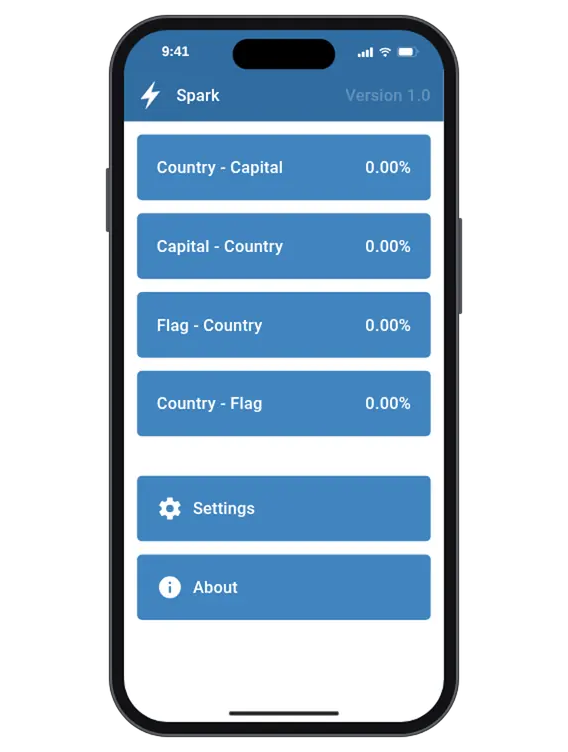

# Spark

[](https://github.com/andrew-markin/spark/actions/workflows/deploy.yml)
[](LICENSE)

<picture>
  <source media="(prefers-color-scheme: dark)" srcset="assets/demo-dark.webp">
  
</picture>

Geography trainer. A progressive web app that drills the capitals and flags of 241 countries and
territories, starting with the best known ones, and keeps asking what you don't know yet until you
do.

**Try it at [spark.mayfleet.com](https://spark.mayfleet.com/).** To use it like an app, offline
too, install it: in Safari on iPhone or iPad tap Share → Add to Home Screen, in Chrome tap Install
app (or Add to Home screen) in the menu.

- **Four courses:** country → capital, capital → country, flag → country and country → flag, each
  with progress of its own.
- **Spaced repetition:** mistakes come back soon, while known answers are checked again less and
  less often.
- **Well known countries first:** the more populous a country, the sooner it is asked, so smaller
  ones join in gradually.
- **English and Russian**, picked by the browser or in the settings, light and dark themes.
- **Keyboard friendly:** Space or Enter reveals the answer, the arrow keys grade it.
- **Works offline** once installed, flags included. Progress stays on the device: no sign-up, no
  ads, no tracking.
- **Free and open source** under the GPL-3.0.

## How to use

1. Pick a course and look at the question: a country, a capital or a flag.
2. Recall the answer, then tap **Reveal the answer** (or press Space / Enter).
3. Be honest: tap **I knew** (→) or **I didn't know** (←).

The percentage in the top corner of a course, also shown on its button on the main screen, is the
share of countries whose last answer was correct. Press and hold it for a second to start the
course over. Progress is kept in the browser's local storage, so it survives reloads and works
offline once the app is installed.

## How questions are picked

Countries are split into ten levels by population, from the least populous (like Pitcairn) to the
most (like China and India). Every answer advances an iteration counter, and for each country the
course remembers the iteration it was last asked at and how many times in a row it was answered
correctly. The next question is drawn at random, weighted as follows:

| Country state                                    | Weight                                   |
| ------------------------------------------------ | ---------------------------------------- |
| Asked in the last 5 iterations                   | almost none, so it doesn't come back yet |
| Never asked                                      | 2^(level − 1), from 1 to 512             |
| Last answer was wrong                            | 4096, before any new country             |
| Answered correctly, before the next check is due | 5% of a new country of its level         |
| Answered correctly, the check is due             | 120% of a new country of its level       |

A check is due 20 iterations after the first correct answer in a row, 60 after the second, 180 after
the third, and so on. So mistakes come back within about ten questions, new countries keep coming
from the best known to the least, and known ones are confirmed every now and then. The rules live in
[`src/trainer.js`](src/trainer.js), and [`src/trainer.test.js`](src/trainer.test.js) checks them on
a simulated learner, which is how the numbers were picked.

## Data

Country names, capitals and populations come from [GeoNames](https://www.geonames.org/), with a few
curated corrections, and the flags from [flag-icons](https://github.com/lipis/flag-icons). Both are
stored in the repository, so the app needs no requests to work. `npm run dataset` refreshes them
with [`dataset.js`](dataset.js): it fetches the countries in English and Russian (a GeoNames username
is set in `.env`, see [`.env.example`](.env.example)), copies the flags into `public/flags` and
updates [`CREDITS.md`](CREDITS.md). Look at the diff before committing.

## Development

Requires Node.js 20.19+ or 22.12+.

```sh
npm install
npm run dev       # dev server at http://localhost:5173
npm test          # unit tests (Vitest)
npm run lint      # oxlint + ESLint, with fixes
npm run format    # Prettier
npm run build     # production build into dist/
npm run preview   # serves the production build
npm run dataset   # refreshes countries and flags, see above
```

The animation above is recorded by `npm run demo` with
[`scripts/demo/record.js`](scripts/demo/record.js), in the light and the dark theme: it builds the
app, plays a scripted session in headless Google Chrome and encodes the screencasts to
`assets/demo-light.webp` and `assets/demo-dark.webp` with ffmpeg. Record them again when the
interface changes.

The build drops the Quasar styles the app doesn't use with
[`plugins/purge-css.js`](plugins/purge-css.js), and generates plain launch images for iPhone and iPad
screens with [`plugins/ios-splash-screens.js`](plugins/ios-splash-screens.js), as iOS ignores the web
app manifest for them. When Apple releases a device with a new screen size, add it to the list
there, otherwise the app launches with a white screen on it.

## Deployment

Every push to `main` is linted, tested, built and published to GitHub Pages via
[GitHub Actions](.github/workflows/deploy.yml), straight from the build with no `gh-pages` branch.
Pull requests go through the same checks without being published, and Dependabot proposes
dependency updates weekly. The custom domain is set in the Pages settings of the repository.

## License

[GNU General Public License v3.0](LICENSE). Data sources and third-party assets are credited in
[CREDITS.md](CREDITS.md).
